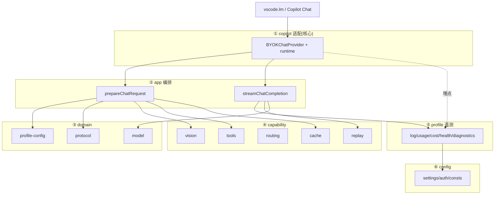

# BYOK for Copilot — 架构设计与改造方案书

> 本文档是后续所有架构改造的**唯一权威参考**。后续新开对话请先阅读本文件,再结合 `/memories/repo/byok-proxy.md`。
>
> 编写时间:2026-08-20。基于对当时源码通读后的分析与设计决策。

---

## 0. 一句话定位

`byok-for-copilot` 是一个 **VS Code 扩展**,通过 `vscode.lm.registerLanguageModelChatProvider('byok', ...)` 把自己注册为 Copilot Chat 的语言模型供应商(vendor = `byok`),让用户用自己的 API Key(**BYOK = Bring Your Own Key**)连接任意 OpenAI 兼容 / Anthropic 兼容后端模型,并尽力**保留甚至增强 Copilot Chat 的原生体验**(模型选择器、工具、视觉、思考/推理),特别是让 **DeepSeek 这类"纯语言、无多模态、未必主动调工具"的模型**尽可能表现得像 Copilot 期望的模型。

---

## 1. 现状架构

### 1.1 目录全景(改造前)

```
src/
  extension.ts              # 入口,仅 re-export runtime 的 activate/deactivate
  auth.ts                   # 基于 SecretStorage 的按端点 API Key 管理
  config.ts                 # ★ 三级配置(端点/风格/模型)的【类型 + getter 全混在这里】
  consts.ts                 # MODEL_TEMPLATES 模型模板、常量、SYSTEM role 常量
  i18n.ts                   # 中英双语文案
  json.ts                   # 安全 JSON 序列化工具
  logger.ts                 # LogOutputChannel 日志
  types.ts                  # BYOK 内部消息/工具/用量类型
  endpoint.ts               # 端点解析辅助
  backend/                  # ★ 后端风格层(按 anthropic / openai / responses 解耦)
    index.ts                #   主代码唯一入口:createClient 工厂 + getRequestBodyBuilder + getVisionProviderAdapter + 错误工具 re-export
    shared/                 #   风格中立契约与基础设施
      contract.ts           #     RequestBodyBuilder / BuildRequestBodyContext / ReasoningReplayConfig / StyleClient / 错误类型
      consts.ts             #     网络错误码 → 分类映射
      vision-utils.ts       #     视觉适配器共用小工具(toBase64/isRecord)
      errors/               #     HTTP/网络错误规范化(index/network)
    anthropic/              #   anthropic-messages 风格全部实现
      client.ts             #     AnthropicClient(SSE, event:/data: 配对)
      request.ts            #     anthropicRequestBodyBuilder
      vision.ts             #     Anthropic 视觉适配器
    openai/                 #   openai-chat 风格全部实现
      client.ts / request.ts / vision.ts
    responses/              #   openai-responses 风格全部实现
      client.ts             #     OpenAIResponsesClient(类型化 SSE 事件)
      request.ts            #     openAIResponsesRequestBodyBuilder
      vision.ts             #     Responses 视觉适配器
      reasoning-cache.ts    #     reasoningStateCache(previous_response_id 链)
      reasoning.ts          #     resolveReasoningReplay:回放决策封装
      debug-input.ts        #     normalizeResponsesInput(诊断用输入归一化)
  provider/                 # ★ 编排核心(目前是一个大目录 + 一个上帝类)
    index.ts                #   BYOKChatProvider 实现 vscode.LanguageModelChatProvider
    models.ts               #   toChatInfo:模型信息 → LanguageModelChatInformation
    request.ts              #   prepareChatRequest:请求装配(核心编排)
    convert.ts              #   convertMessages / convertTools:消息与工具格式转换
    cache.ts                #   推理状态缓存
    proxy.ts                #   undici dispatcher 代理(跟随系统/直连)
    segment.ts              #   会话分段(conversation segment id)
    stream.ts               #   streamChatCompletion:SSE 流式回传 + 工具/推理回放 + token 校准
    tokens.ts               #   estimateTokenCount(chars-per-token)
    routing/                #   classifier.ts 请求类型分类(manage_todo_list / categorize_prompt / 系统提示前缀)
    debug/                  #   diagnostics.ts(缓存/工具流诊断)、dump.ts(请求转储)
    replay/                 #   推理回放 markers(consts/markers/types)
    pricing/                #   costs.ts / currency.ts(费用/币种)
    tools/                  #   flow.ts / preflight.ts / consts.ts / notices.ts / request.ts
    vision/                 #   视觉代理(bridge + VS Code LM fallback + 协议客户端 + UI)
  runtime/                  # 生命周期/命令/动作/诊断/欢迎
    index.ts / lifecycle.ts / provider.ts / commands.ts / actions.ts
    diagnostics.ts / welcome.ts
  sidebar/                  # 端点管理树 + config 面板(html/panel/modelHtml/modelPanel)
  stats/                    # 用量统计(usage/store/tracker/tree/panel/html)
```

### 1.2 生命周期流(runtime/lifecycle.ts → registerProvider)

```
activate:
  initializeDiagnostics(context)      # 诊断
  initializeUsageTracker(context)     # 用量统计(globalState)
  registerCommands(context)           # 命令
  registerActionUrls(context)         # URI 动作
  registerUsageStatsSidebar + openStatsPanel 命令
  registerProvider(context)           # ★ 注册 LanguageModelChatProvider + 侧栏 + 欢迎
```

`registerProvider`(runtime/provider.ts):
- `new BYOKChatProvider(context)`
- 注册命令:`setApiKey / clearApiKey / deleteEndpointApiKey / setVisionModel`
- `vscode.lm.registerLanguageModelChatProvider('byok', provider)`
- `activateCopilotChat()` 激活 `github.copilot-chat` 后再 `refreshModelPicker()`

### 1.3 Provider 的核心三方法(provider/index.ts)

| 方法 | 职责 |
|---|---|
| `provideLanguageModelChatInformation` | 遍历 端点×风格×模型,用 `MODEL_TEMPLATES` 生成模型列表;模型 ID 形如 `模型@端点名` |
| `provideLanguageModelChatResponse` | 完整请求链路:分段→分类→工具流→装配→流式回传 |
| `provideTokenCount` | 用自适应 chars-per-token(EMA)估算 |

**请求链路(provideLanguageModelChatResponse):**

```
messages, options
  → resolveConversationSegment(messages)         # 分段 segment
  → classifyProviderRequest(...)                 # 分类 requestKind
  → dumpProviderInput(...)                       # verbose 时转储原始输入
  → processToolFlow(...)                         # tools/flow.ts 工具流(见 §2.4)
  → prepareChatRequest(...)                      # request.ts 装配
  → streamChatCompletion(...)                    # stream.ts 流式回传
```

### 1.4 三级配置模型(config.ts)

```
EndpointConfig(name, baseUrl, styles)
  └─ EndpointStyleConfig(baseUrl, authType, anthropicVersion, models[], supportsReasoningReplay, ...)
       └─ EndpointModelEntry(string | {id, displayName, family, version, capabilities, pricing, ...})
```

关键 getter:`getEndpoints / getEndpointByName / getEndpointForModel / getEnvironment / getModelBaseUrl(三级优先级) / getProxyConfig / getStabilizeToolListEnabled / getStoreReasoningEnabled / isReasoningReplaySupported / resolveEndpointsTarget`

---

## 1.5 配置全集:端点-风格-模型 三级(模型优先)

> **本小节是设计阶段的权威配置清单,与 `src/config.ts` + `package.json #configuration` 一一对应。**
> 作用:在设计期把每层可配置项固定下来,后续再决定**哪些保留 / 哪些废弃**。每项按暴露状态分类:
> - ✅ = 已在 `package.json` schema 暴露(用户可直接在设置里配)
> - ⚠️ = 代码已读取但 **schema 未暴露**(需在"转正/废弃"决策时处理)
> - 🧪 = experimental / 遗留(仅高级用户或迁移使用)

### 1.5.1 全局设置(非三级,`byok-copilot.*` 顶层)

| 配置 key | 类型 | 默认 | 分级 | 说明 |
|---|---|---|---|---|
| `endpoints` | `array` | `[]` | ✅ | 三级端点列表(见 1.5.2) |
| `maxTokens` | `number` | `0` | ✅ | 最大输出 token;`0` = 用 API 默认(无上限) |
| `experimental.stabilizeToolList` | `boolean` | `false` | ✅🧪 | 稳定/压缩首轮 `activate_*` 工具集(见 §2.4) |
| `modelIdOverrides` | `object` | `{}` | ✅ | 模型 ID 覆盖(第三方 API 代理用),如 `{"byok-v4-flash":"deepseek-chat"}` |
| `visionModel` | `string` | `""` | ✅ | 视觉代理使用的模型 ID |
| `visionPrompt` | `string` | (内置提示词) | ✅ | 视觉描述提示词(多行);模型级 `visionPrompt` 可覆盖它 |
| `debugMode` | `enum` | `minimal` | ✅ | `minimal \| metadata \| verbose`;`verbose` 才启用 request dump |
| `privacy.reportUsageToChat` | `boolean` | `true` | ✅ | 用量(tokens)是否同步给本地 Copilot Chat 展示;关闭则仅本地统计 |
| `storeReasoning` | `boolean` | `true` | ⚠️ | 是否启用有状态推理回放(`previous_response_id` / `encrypted_content`)。**config.ts 已读,但 schema 未暴露** |
| `debug`(遗留) | `boolean` | `false` | 🧪 | 遗留布尔诊断开关,`activate` 时自动迁移到 `debugMode` 并清除 |

### 1.5.2 端点级 `EndpointConfig`(每项 schema 暴露)

| 字段 | 类型 | 必填 | 说明 |
|---|---|---|---|
| `name` | `string` | ✅ | 端点唯一名,也作为 `模型ID@端点名` 的后缀 |
| `baseUrl` | `string` | ✅ | 端点基础 URL(去尾斜杠);可被风格/模型级覆盖 |
| `proxy` | `object` | — | 端点级代理,最低优先级(见 1.5.5) |
| `styles` | `object` | — | 三风格容器(见 1.5.3),核心三级结构 |

> 遗留平面字段(旧格式自动归一化):顶层 `models[]` + `protocol` + `anthropicVersion`,兼容读取后折进 `styles`。

### 1.5.3 风格级 `EndpointStyleConfig`(端点下按 `openai-chat / openai-responses / anthropic-messages` 三键)

| 字段 | 类型 | 适用范围 | 说明 |
|---|---|---|---|
| `models` | `array<(string \| object)>` | 全部 | 该风格承载的模型列表(见 1.5.4) |
| `baseUrl` | `string` | 全部 | 风格级 baseUrl 覆盖(端点级之下、模型级之上) |
| `authType` | `enum` | 全部 | `bearer \| x-api-key` |
| `proxy` | `object` | 全部 | 风格级代理(端点之下、模型之上) |
| `anthropicVersion` | `string` | `anthropic-messages` | Claude API 版本头 |
| `supportsReasoningReplay` | `boolean` | `openai-responses` | 是否支持 Responses 有状态推理回放,默认 `false` |

### 1.5.4 模型级 `EndpointModelEntry`(风格下 `models` 数组项;可为字符串 `"id"` 或对象)

| 字段 | 类型 | 说明 |
|---|---|---|
| `id` | `string` | **必填**。模型 ID(前后端主键) |
| `displayName` | `string` | 模型选择器显示名 |
| `baseUrl` | `string` | 模型级 baseUrl 覆盖(**最高优先**) |
| `authType` | `enum` | 模型级 `bearer \| x-api-key` |
| `proxy` | `object` | 模型级代理(**最高优先**,见 1.5.5) |
| `family` / `version` | `string` | 目录/版本标签(展示) |
| `detail` | `string` | 模型描述 |
| `maxInputTokens` / `maxOutputTokens` | `number` | token 上限;未填则回落模板/AI 默认 |
| `capabilities.toolCalling` | `boolean \| number` | 工具调用能力 |
| `capabilities.imageInput` | `boolean` | 是否支持图像输入(**纯语言模型为 `false`,触发 vision 代理**) |
| `capabilities.thinking` | `boolean` | 是否支持思考模式 |
| `requiresThinkingParam` | `boolean` | 是否需显式 thinking 参数 |
| `pricing` | `object` | 价格(USD/CNY × cacheHit/cacheMiss/output) |
| `priceCategory` | `enum` | `low \| mid \| high` |
| `visionPrompt` | `string` | 模型级视觉提示覆盖(优先于全局 `visionPrompt`) |
| `protocol` | `string` | (遗留)模型级协议枚举,归一化用 |
| `anthropicVersion` | `string` | (遗留)模型级 Claude 版本 |

### 1.5.5 代理 `ProxyConfig`(端点/风格/模型三级共用同一 shape)

| 字段 | 类型 | 说明 |
|---|---|---|
| `mode` | `enum` | **必填**。`system`(跟随系统代理/EnvHttpProxyAgent) \| `direct`(直连) \| `proxy`(固定 url) |
| `url` | `string` | 仅 `mode=proxy` 需填,`http://` 或 `https://` |
| `noProxy` | `array<string>` | NO_PROXY 式跳过域名 |

### 1.5.6 三级覆盖优先级(模型优先)——**重要**

```
baseUrl      :  模型级 > 风格级 > 端点级                    (getModelBaseUrl)
proxy        :  模型级 > 风格级 > 端点级 > system 默认      (getProxyConfig)
visionPrompt :  模型级 > 全局 visionPrompt
authType     :  模型级 / 风格级(就近)
```

对应 getter 与代码 index:

| 关注点 | getter | 位置 |
|---|---|---|
| 全部端点 | `getEndpoints()` | `config.ts normalizeEndpointConfig` |
| 按名/按模型找端点 | `getEndpointByName` / `getEndpointForModel` | `config.ts` |
| 解析模型所属风格+条目 | `getResolvedStyleModel` | `config.ts` |
| 三级 baseUrl | `getModelBaseUrl` | `config.ts`(model \|\| style) |
| 三级 proxy | `getProxyConfig` | `config.ts`(model \|\| style \|\| endpoint \|\| system) |
| 模型定义对象 | `getEndpointModelDef` | `config.ts` |

> **改造指导**:1.5.2~1.5.5 的**纯类型与归一化逻辑**(`normalizeEndpointConfig`、`normalizeStyle`、`normalizeProxy`、三级覆盖优先级)应抽到 `domain/profile-config/`(纯 TS,零 VS Code);`config.ts` 保留 getter 并 re-export 类型。`storeReasoning`、遗留 `debug` 在 Phase 3 的"配置项清点"中决定转正暴露或废弃。

---

## 2. 关键功能真相(基于代码证据,改造前必须理解)

### 2.1 三种协议客户端是"对等平行"的,由工厂分发

`createClient(style, baseUrl, apiKey, options)` 按风格返回:
- `openai-chat` → `OpenAIClient`
- `openai-responses` → `OpenAIResponsesClient`
- `anthropic-messages` → `AnthropicClient`

三者均基于 **Node 全局 fetch + `response.body.getReader()` 消费 SSE**,且都接收 `options.dispatcher`(undici)以支持代理。新增协议只需新增一个客户端目录 + 工厂分支。

### 2.2 vision 的目的 —— 让"没有眼睛"的纯语言模型能看图

- **触发原因**:DeepSeek 系列无多模态能力,不支持图像输入;后期可扩展到其他纯语言模型。
- **机制**:BYOK 在把请求发往后端前,把 Copilot 传来的图像解析为文字描述(内部代理桥 + VS Code LM 回落),再重建消息。
- 模块:`provider/vision/`(service、resolve、protocols/client 及 anthropic/openai 各风格、sources/endpoint|vscode、ui 面板)。

### 2.3 replay(reasoning replay)的目的 —— 跨轮保留推理状态

- **触发原因**:OpenAI Responses / 部分后端有**有状态推理**(`previous_response_id`、`reasoning.encrypted_content`,见 `types.ts` 的 `reasoning_encrypted_content` 与 `Types.ts` onReasoningToken/onReasoningReplay)。
- **机制**:纯翻译时 `reasoning_content` 会被丢(Copilot 只显示概览、不跨轮保留推理 token)。BYOK 用 `replay/markers.ts` + `consts.ts` 的 `stateful_marker`(`REPLAY_MARKER_MIME`)在消息里夹带状态标记,下一轮取出重新注入(`config.getStoreReasoningEnabled` / 端点 `supportsReasoningReplay`)。
- **结论**:这是 BYOK 桥接层的**专属增值**,不依赖 Copilot,不重复。仅对声明 `supportsReasoningReplay` 的端点生效;普通端点走 `output_text`,无副作用。

### 2.4 tools/flow 的 preflight —— **真实目的 = 控制首次 prompt 的工具集长度**(重要更正)

> ⚠️ 这是本次会话最重要的认知更正,后续人必须按此理解,勿误读成"BYOK 在帮 Copilot 代答真实工具"。

- `tools/consts.ts`:`ACTIVATE_TOOL_PREFIX = 'activate_'`,`MAX_PREFLIGHT_ROUNDS_PER_USER_REQUEST = 3`
- `config.getStabilizeToolListEnabled()` 读取 `experimental.stabilizeToolList`,**默认 `false`**。
- **机制**(`tools/flow.ts`):Copilot Chat 会把一批 `activate_*` 前缀的**虚拟激活工具**(用于激活 agent / skill)注入 `options.tools`。`inspectActivatePreflight` 检查这些 `activate_*` 是否都已被调用过;若有未调用的(`remainingActivatorNames`),BYOK **不发请求**,而是用 `progress.report(new LanguageModelToolCallPart(...))` 代发一次激活调用并 `preflightHandled=true` 短路返回。
- **真实目的**:让 Copilot 侧认为"激活已完成",**下一轮就不再重复注入全量 `activate_*`**,从而**压制首轮工具集长度**,避免纯语言模型因不熟悉大量虚拟工具而误调/漏调,同时省 prompt 上下文。
- **普通工具与 preflight 无关**:`prepareRequestTools`(tools/request.ts)对普通工具只做 `convertTools(options.tools)` 透传;谁调用、如何执行、结果回喂全部由 Copilot agent loop 负责。BYOK 完全不插手普通工具的激活。
- **结论(是否保留)**:**保留**,但必须维持"默认关闭 + experimental",并把它"正名"为"按需压缩首轮虚拟工具集",而不是"代答工具"。必要时可按后端工具能力做 feature-flag 差异化。

### 2.5 已识别的具名 Copilot 工具(代码证据)

- `manage_todo_list` → `todo-tracker`(`classifier.ts isOnlyTool`)
- `categorize_prompt` → `prompt-categorizer`
- `activate_<agent|skill>` 家族 → 虚拟激活工具,数量不固定、最占空间(只按前缀统计,不解析语义,dump 有 `activateToolCount`)

其余真实工具(编辑文件、终端、搜索、读文件等)**在仓库内未被具名引用**,因为 BYOK 只做透传,不关心其业务语义。

`classifier.ts` 还按系统提示前缀识别 hidden 请求形态(通常单工具或不带工具):todo-tracker / prompt-categorizer / settings-resolver / chat-title / inline-progress-message / git-branch-name / git-commit-message / rename-suggestions / main-agent 等。工具集大小由 agent、启用的扩展、skills/agents 数量、请求类型决定。

---

## 3. 目标架构(改造后)

### 3.1 设计原则

1. **依赖单向**:上层依赖下层,禁止反向/循环。
2. **VS Code 耦合收敛到"适配层"**:领域/能力层尽量纯 TS,可脱离 VS Code 单测。
3. **Copilot 适配层是核心价值所在**(不是降级)——它是"网关 + 体验增强"的总闸门;协议/模型只是它的积木。
4. **观测(profile)与配置分离**:profile 只记录统计,不做业务决策。
5. **避免"上帝目录"**:横切能力独立成包,不塞进"核心"。

### 3.2 分层(六分组,来自会话讨论并修正)

```
┌─────────────────────────────────────────────────────────────┐
│ ① copilot适配层(核心)                                       │
│    网关 + 增强:模型选择器、请求网关、响应/工具/推理呈现       │
│    对应:provider/index.ts(BYOKChatProvider) + runtime/       │
├─────────────────────────────────────────────────────────────┤
│ ② app/ 编排层(用例)                                          │
│    一条链路的编排:prepareChatRequest + streamChatCompletion   │
│    薄 VS Code,把领域/能力粘起来                              │
├─────────────────────────────────────────────────────────────┤
│ ③ domain/ 领域层(纯 TS,尽量零 VS Code)                       │
│    · protocol/ 三协议客户端 + 工厂   · model/ 模型模板·chatInfo·tokens│
│    · profile-config/ 三级端点/风格/模型【纯类型+默认值】       │
├─────────────────────────────────────────────────────────────┤
│ ④ capability/ 横切能力层(独立成包,各自单一职责)              │
│    vision/ tools/ routing/ replay/ cache/ proxy/             │
├─────────────────────────────────────────────────────────────┤
│ ⑤ profile/ 遥测层(观测,不决策)                               │
│    log(收敛 logger)  usage(用量globalState)  cost(费用/币种)  │
│    health(连接/健康/延迟,【新增】)  diagnostics(缓存/工具流诊断+request dump)│
│    统一面板(用量/连接/诊断)                                   │
├─────────────────────────────────────────────────────────────┤
│ ⑥ config/ 配置适配层                                         │
│    settings 读写 + schema 注册 + auth(SecretStorage) + consts │
└─────────────────────────────────────────────────────────────┘
```

建议目录:

```
src/
  domain/
    protocol/     # client/{openai,responses,anthropic}、工厂
    model/        # 模型模板、models.ts(toChatInfo)、tokens.ts
    profile-config/  # 三级配置的【数据结构与默认值】(纯TS)
  capability/
    vision/  tools/  routing/  replay/  cache/  proxy/
  app/            # request.ts + stream.ts(用例编排)
  copilot/        # Provider 实现 + runtime + sidebar + stats 面板(核心)
  config/         # settings 读写 + schema + auth + consts
  profile/        # 聚合 log/ usage/ cost/ health/ diagnostics + 统一面板
  extension.ts
```

### 3.3 依赖方向(mermaid)



---

## 4. 分步改造方案(低风险优先,每步保持编译+行为)

> 每步都是可独立交付的小步,切忌一次性大搬迁。**先拆函数,再搬文件。**

### Phase 0 — 建立验证基线
- 确认 `npm run compile`(`clean && tsc -p ./`)通过。
- 有条件的跑一次真实请求(verbose dump),记录现状 `toolCount / activateToolCount`,作为改造前后的对照基线。

### Phase 1(最高收益、零行为风险):从 `config.ts` 剥离 profile 纯类型
- 目标:把 `EndpointConfig / EndpointStyleConfig / EndpointModelEntry` 的**类型定义与纯 merge/默认值逻辑**抽到 `domain/profile-config/`,不依赖 VS Code。
- 做法:先在 `config.ts` 内把"纯数据逻辑"(normalize、resolve、默认值)与"VS Code getter"分开;再搬纯部分。`config.ts` 保留 getter 并 re-export 类型,避免波及调用方。
- 验收:编译通过,`getEndpoints` 等行为不变。

### Phase 2:拆解 `provider/index.ts` 上帝类
- 现行 `BYOKChatProvider` 混入:模型列表构建、命令处理(configureApiKey/clearApiKey/deleteEndpointApiKey/setVisionModel)、response 链路。
- 拆法:
  - `modelListBuilder.ts`:`provideLanguageModelChatInformation` 的三重枚举 + 模板合并逻辑。
  - `commands.ts` 已存在(runtime/commands.ts),把 Provider 上的命令方法迁移/委托过去。
  - `provider/index.ts` 只保留三方法 + 成员注入的聚合。
- 验收:行为不变,`onDidChangeLanguageModelChatInformation` 触发逻辑保持。

### Phase 3:收敛日志/用量/费用/诊断到一个 `profile/` 目录
- 把 `logger.ts`、`stats/`、`provider/pricing/`、`provider/debug/` **聚合导出**到 `src/profile/`,统一入口 `import { profile } from '../profile'`。
- 新增最小的 `profile/health/`:记录每端点 最近请求时间/成功失败数/延迟/最后错误/连接状态(ok|unreachable|error)。只记录不决策,由埋点方调用。
- 保持原有 `stats` / `debug` 的持久化与面板行为不变,仅改导入路径。
- 验收:编译通过;日志/用量面板行为不变。

### Phase 4:把 `preflight` 从主路径收敛为可选步骤 + 正名
- 现状已在 `tools/flow.ts` 通过 `if (!stabilizeToolList) return {preflightHandled:false,...}` 短路,本就是可选。
- 正名:重写 `flow.ts`、`preflight.ts`、`consts.ts` 的注释,明确"目的是压缩首轮 activate_* 工具集,而非代答真实工具"。
- 加固(可选):按端点/模型能力差异化开关;增加"实测砍掉多少个 activate 工具"的诊断日志(`formatActivateToolNames` 已有,dump.ts 可复用)。
- 验收:`stabilizeToolList` 默认 false 行为不变;开启后行为与现状一致。

### Phase 5:按目标目录做整体搬迁
- 在所有 Phase 完成、行为稳定后,把 `client/`→`domain/protocol/`、`provider/{models,tokens,consts}`→`domain/model/`、`provider/{vision,tools,routing,replay,cache,proxy}`→`capability/`、`provider/{request,stream}`→`app/`、`provider/index.ts`+`runtime/`→`copilot/`、`config/auth/consts`→`config/`。
- 使用编辑器/tsc 的引用重命名与移动功能,按依赖自底向上搬:domain → capability → app → copilot → config → profile。
- 验收:全量 `npm run compile` 通过;功能回归。

### Phase 6(可选,后续):健康/遥测面板
- 基于 `profile/health` 数据,在侧栏或独立面板展示端点连接状态、延迟、成功率。
- 不急于 Phase 1-5 之前做。

---

## 5. 关键风险与注意

1. **打包陷阱(已修复的教训)**:`.vscodeignore` 的 `node_modules/**` 会排除生产依赖 `undici` → `require('undici')` 失败 → 激活失败/侧栏空/命令未注册/Copilot `'e is not iterable'`。修复:`!node_modules/undici/**`。打包前 `npx vsce ls` 确认。**搬迁/依赖改动后务必复验。**
2. **fetch 与代理**:三客户端用 Node 全局 fetch,默认直连不走系统代理;走 env 代理需 `NODE_USE_ENV_PROXY=1` 或 `EnvHttpProxyAgent`。代理通过 `dispatcher` 注入(见 `/memories/repo/byok-proxy.md`)。
3. **协议细节强耦合**:`REPLAY_MARKER_WRITER_ID = 'byok-copilot'`、`ACTIVATE_TOOL_PREFIX = 'activate_'` 与 Copilot Chat 消息格式强耦合,`github.copilot-chat` 升级可能破坏,需做兼容位。
4. **preflight/replay 对健壮模型是净开销**:维持 feature-flag 关闭,开启时应完全透明(当前 `stabilizeToolList`/`storeReasoning` 方向正确)。
5. **`provideLanguageModelChatInformation` 偏重**:三重循环全量枚举,改造时可抽 `ModelListBuilder`,避免后续"上帝类"复现。
6. **多窗口**:SecretStorage 变化会刷新模型选择器;config 变化用 JSON 快照判断避免空刷。改造不要破坏这两个监听。

---

## 6. 附:工具/请求相关代码索引

| 概念 | 位置 |
|---|---|
| 工具集统计(toolCount/activateToolCount/toolNames) | `provider/debug/dump.ts` `getToolNames` `getActivateToolNames` `summarizeTools` |
| 工具透传 | `provider/convert.ts` `convertTools` |
| preflight 流程 | `provider/tools/flow.ts` `inspectActivatePreflight` |
| preflight 常量 | `provider/tools/consts.ts` `ACTIVATE_TOOL_PREFIX` `MAX_PREFLIGHT_ROUNDS_PER_USER_REQUEST` |
| 请求类型分类 + 具名工具 | `provider/routing/classifier.ts` |
| 推理回放标记 | `provider/replay/markers.ts`、`consts.ts`、`types.ts` |
| 配置(三级) | `data/config.ts`(改造后迁 `domain/profile-config`) |
| 请求装配 | `provider/request.ts` `prepareChatRequest` |
| 流式回传 | `provider/stream.ts` `streamChatCompletion` |
| 用量统计 | `stats/` |
| 费用/币种 | `provider/pricing/` |
| 代理 | `provider/proxy.ts` |

---

## 7. 本会话已确认的决策摘要(供快读)

- ✅ 结构合理,属"接口驱动 + 分层解耦"的 VS Code 扩展;主要痛点 = `config.ts` 混型、`provider/index.ts` 上帝类、观测散落。
- ✅ 六分组方向:**copilot适配(核心)/ app编排 / domain(协议·模型·profile-config)/ capability / profile遥测 / config**。
- ✅ vision = 为无多模态纯语言模型补"眼睛";replay = 为有状态推理补"跨轮";preflight = 为弱工具模型压缩首轮激活工具集(**非代答真实工具**)。
- ✅ preflight 保留,但维持默认关、experimental、并正名。
- ✅ 改造顺序:Phase 1 剥离 profile 类型 → Phase 2 拆上帝类 → Phase 3 收敛 profile → Phase 4 preflight 正名 → Phase 5 整体搬迁 → Phase 6 健康面板。

---

## 附录 A:Claude(Anthropic Messages)接入指南 与 项目实现对照

> 本附录是 Anthropic 风格协议客户端(`domain/protocol/anthropic/`)的接入参考,由用户提供的官方指南 + 与本仓库 `src/client/anthropic/core.ts` 逐条对照校验而成。改造/维护该客户端时以本附录为准。

### A.1 核心请求头与鉴权(Headers)

调用 Claude API 必须含三个 HTTP Header,漏传/传错会导致认证失败:

```http
POST /v1/messages HTTP/1.1
Host: api.anthropic.com
Content-Type: application/json
x-api-key: sk-ant-api03-xxx...
anthropic-version: 2023-06-01
```

✅ 与项目一致:`AnthropicClient` 构造器默认 `anthropicVersion='2023-06-01'`,请求头正是这组;路径为 `fetch(`${baseUrl}/v1/messages`)`。

### A.2 请求体(Request Body)

**基础文本对话:**
```json
{
  "model": "claude-3-7-sonnet-20250219",
  "max_tokens": 1024,
  "system": "你是一个严谨的 Node.js/TypeScript 专家。",
  "messages": [{ "role": "user", "content": "..." }]
}
```

**思维链(Thinking,如 Claude 3.7):**
```json
{
  "model": "claude-3-7-sonnet-20250219",
  "max_tokens": 4096,
  "thinking": { "type": "enabled", "budget_tokens": 2048 },
  "messages": [{ "role": "user", "content": "..." }]
}
```
> `budget_tokens` 从 `max_tokens` 中扣除;项目通过 `capabilities.thinking` + `requiresThinkingParam` 判断是否注入 thinking。

**视觉输入(Vision):**
```json
{
  "model": "claude-3-5-sonnet-20241022",
  "max_tokens": 1024,
  "messages": [{
    "role": "user",
    "content": [
      { "type": "image", "source": { "type": "base64", "media_type": "image/png", "data": "iVBOR..." } },
      { "type": "text", "text": "请描述这张图片里的内容。" }
    ]
  }]
}
```
> ⚠️ **笔误修正**:`text` 块字段名是 **`text`**(不是 `content`)。image 块才是 `source{type, media_type, data}` 结构。BYOK 本身用 vision 代理做"图→文描述"的重建,此结构主要用于代理/直连场景。

**消息交替限制(坑):**
- 一条请求时首条消息必须是 `user`。
- 不能出现"两个无 tool_result 的连续 user"。
- 但在多轮工具调用里,允许 `user → assistant(tool_use) → user(tool_result)` 这种"user 紧接 user"——因为后一个 user 携带前一个 assistant 的 `tool_result`,属于合法。
- 项目 `convert.ts` 正是靠 `LanguageModelToolResultPart` 生成这些 `user(tool_result)` 消息。

### A.3 响应格式(非流式 200 OK)

```json
{
  "id": "msg_013Z...",
  "type": "message",
  "role": "assistant",
  "model": "claude-3-7-sonnet-20250219",
  "content": [
    { "type": "thinking", "thinking": "...", "signature": "ErQBCgN..." },
    { "type": "text", "content": "..." }
  ],
  "stop_reason": "end_turn",
  "stop_sequence": null,
  "usage": { "input_tokens": 25, "output_tokens": 312 }
}
```

### A.4 流式响应(SSE,`"stream": true`)

Claude SSE 用 `event:` + `data:` 行对,含类型化事件:

| 事件 | 含义 |
|---|---|
| `message_start` | 消息初始元数据 + `usage.input_tokens` |
| `content_block_start` | 新内容块开始(文本/思维链/tool_use) |
| `content_block_delta` | **核心增量包**:`delta.text` / `delta.thinking` / `delta.signature` / `delta.partial_json` |
| `content_block_stop` | 当前块结束(工具块在此解析 JSON 参数并触发 tool call) |
| `message_delta` | **增量** `usage.output_tokens` + `stop_reason`(项目用它累计 output token 并触发 onUsage) |
| `message_stop` | 整条生成完毕 |
| `ping` | 空闲保活,忽略 |
| `error` | 错误事件 |

示例流(与项目解析逐条对应):
```
event: message_start
data: {"type":"message_start","message":{"id":"msg_123","role":"assistant","usage":{"input_tokens":12,"output_tokens":1}}}
event: content_block_start
data: {"type":"content_block_start","index":0,"content_block":{"type":"text","text":""}}
event: content_block_delta
data: {"type":"content_block_delta","index":0,"delta":{"type":"text_delta","text":"微风"}}
event: content_block_stop
data: {"type":"content_block_stop","index":0}
event: message_stop
data: {"type":"message_stop"}
```

### A.5 原生 fetch 最小封装(参考)

```ts
import { Agent, ProxyAgent, EnvHttpProxyAgent } from 'undici'; // 推荐 npm 包,而非 node:undici

export async function callClaudeApi(opts: {
  apiKey: string; endpoint?: string; model?: string; systemPrompt?: string; prompt: string;
}) {
  const { apiKey, endpoint = 'https://api.anthropic.com/v1/messages', model = 'claude-3-7-sonnet-20250219', systemPrompt, prompt } = opts;
  const headers = { 'Content-Type': 'application/json', 'x-api-key': apiKey, 'anthropic-version': '2023-06-01' };
  const body = { model, max_tokens: 2048, ...(systemPrompt && { system: systemPrompt }), messages: [{ role: 'user', content: prompt }] };
  const response = await fetch(endpoint, { method: 'POST', headers, body: JSON.stringify(body) });
  if (!response.ok) throw new Error(`Claude API Error [${response.status}]: ${await response.text()}`);
  const data = await response.json();
  const textBlock = data.content.find((b: any) => b.type === 'text');
  return textBlock ? textBlock.text : '';
}
```

### A.6 代理接入的注意

- 项目不直接用 `node:undici` 的 `Agent`,而是经 `import('undici').Dispatcher` 注入 `dispatcher`(由 `provider/proxy.ts` 解析出 `ProxyAgent` / `EnvHttpProxyAgent` / `Agent`)。
- 直连:`Agent`;跟随系统代理:`EnvHttpProxyAgent`;固定代理:`ProxyAgent({ uri })`。SOCKS 暂不支持。
- 因此 `AnthropicClient` 的 `dispatcher` 字段会原样塞进 `RequestInit.dispatcher`。

### A.7 对照小结

| 你提供的说明点 | 项目 `anthropic/core.ts` | 一致 |
|---|---|---|
| 三 header(x-api-key + anthropic-version) | `headers` 逐项对应 | ✅ |
| `POST /v1/messages` | `fetch(baseUrl+'/v1/messages')` | ✅ |
| `event:`/`data:` 配对解析 | 按行解析 | ✅ |
| `thinking_delta` / `signature_delta` | `block.thinking`/`block.signature` 累加 + `onThinking` | ✅ |
| `input_json_delta`(工具参数 partial_json) | `block.input` 累加 | ✅ |
| `tool_use` → tool call | `content_block_stop` 时 `onToolCall` | ✅ |
| `message_delta`(usage) | 累加 output_tokens + `onUsage` | ✅(用户说明未列) |
| `ping` 保活 | 忽略 | ✅(用户说明未列) |

**需修正的点**:① vision `text` 块用 `text` 字段而非 `content`;② 代理 import 用 `undici` npm 包而非 `node:undici`;③ 事件清单可补 `message_delta` 与 `ping`。
