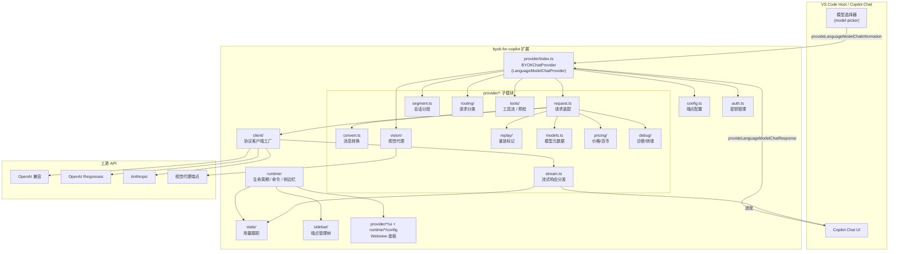
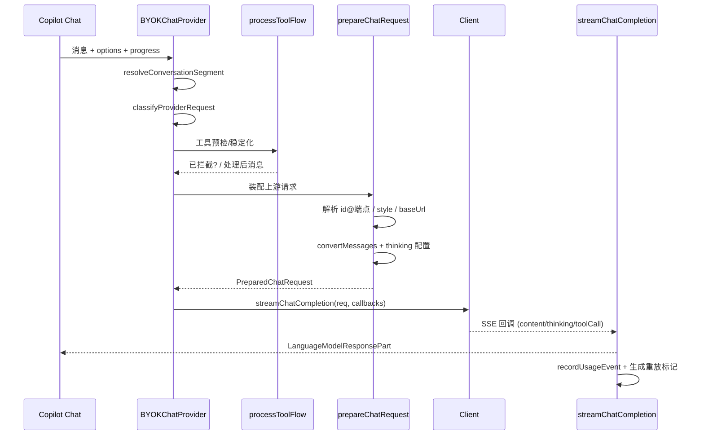

# BYOK for Copilot Chat — 架构书（Architecture）

> 本文档描述 `byok-for-copilot` 扩展的整体架构、模块职责与关键数据流。
> 项目基于 [deepseek-v4-for-copilot](https://github.com/Vizards/deepseek-v4-for-copilot) 重构而来，核心目标是把**任意第三方 OpenAI / Anthropic 兼容大模型**接入 VS Code Copilot Chat 的模型选择器。

---

## 1. 概述

BYOK（Bring Your Own Key）扩展通过实现 VS Code 的 `vscode.LanguageModelChatProvider` API，将用户自有的 API Key 与模型注册到 Copilot Chat 中。其能力包括：

- **双协议对等**：OpenAI Chat（`/chat/completions`）、OpenAI Responses（`/responses`）、Anthropic Messages（`/v1/messages`）三种风格作为**同级对等**存在。
- **工具调用（Tool Call）**：支持流式 delta 解析、thinking/reasoning 流式输出。
- **视觉代理（Vision Proxy）**：为不具备原生多模态能力的模型提供图片理解。
- **多端点管理**：Activity Bar 侧边栏 + 设置，支持 `Endpoint → Style → Model` 三层结构。
- **重放标记（Replay Markers）**：通过上下文缓存降低请求成本。
- **用量统计**：按模型长期记录 token / 缓存命中率，侧边栏 + 统计面板展示。

激活方式：`onStartupFinished` / `onUri`。`main` 入口为 `./out/extension.js`（由 `src/extension.ts` 直接 re-export `./runtime`）。

---

## 2. 整体架构



---

## 3. 模块职责

### 3.1 `runtime/` — 扩展生命周期与宿主集成

| 文件 | 职责 |
| --- | --- |
| `lifecycle.ts` | `activate` / `deactivate`：依次初始化诊断、用量跟踪器、命令、Action URL、统计侧边栏、Provider、端点侧边栏、欢迎页。 |
| `provider.ts` | `registerProvider`：实例化 `BYOKChatProvider`，注册命令（`setApiKey`/`clearApiKey`/`setVisionModel` 等）并通过 `vscode.lm.registerLanguageModelChatProvider('byok', provider)` 注册。 |
| `commands.ts` / `actions.ts` | 命令与错误 Action URL 注册。 |
| `tree.ts` / `sidebar/` | Activity Bar 端点管理树与配置 Webview 面板。 |
| `config/` | 端点配置的 Webview 面板（`panel.ts` / `html.ts`）。 |
| `welcome.ts` | 首次激活欢迎提示。 |
| `diagnostics.ts` | 诊断通道初始化。 |

### 3.2 `provider/index.ts` — 核心 Provider

实现 `vscode.LanguageModelChatProvider`，是扩展与 Copilot Chat 的契约面：

- **`provideLanguageModelChatInformation`**：遍历所有端点 × 风格 × 模型，生成 `LanguageModelChatInformation`（含 `isBYOK` / `isUserSelectable` / `statusIcon` / `configurationSchema` / 价格信息），并暴露 `onDidChangeLanguageModelChatInformation` 事件触发模型选择器刷新。
- **`provideLanguageModelChatResponse`**：单次对话请求的总入口，串联分段解析 → 请求分类 → 工具预检 → 请求装配 → 流式响应。
- **`provideTokenCount`**：基于自适应 `charsPerToken`（指数滑动平均，由真实用量校准）估算 token。

维护的关键状态：`AuthManager`、`vision` 服务、`BalanceCurrencyResolver`、`cacheDiagnostics`、`charsPerToken`。

### 3.3 `client/` — 协议客户端层

`createClient(style, baseUrl, apiKey, options)` 工厂根据 `EndpointStyle` 返回对应客户端，三者运行时共享 `streamChatCompletion(request, callbacks, token)` 签名：

- `openai/core.ts` `OpenAIClient` → `POST {baseUrl}/chat/completions`，标准 SSE（`data: ` + `[DONE]`）。
- `responses/core.ts` `OpenAIResponsesClient` → `POST {baseUrl}/responses`，带 `type` 字段的 typed SSE 事件流。
- `anthropic/core.ts` `AnthropicClient` → `POST {baseUrl}/v1/messages`，`event:`+`data:` 配对 SSE，使用 `x-api-key` + `anthropic-version` 鉴权。
- `error/`：统一的 `createHttpError` / `createUserFacingError` / `normalizeRequestError` 错误模型。
- `types.ts`：跨客户端共享的 `BYOKRequest` / `BYOKStreamChunk` / `BYOKToolCall` / `BYOKUsage` / `StreamCallbacks`。

> 客户端仅依赖 Node 内置 `fetch`，无外部 HTTP 依赖。

### 3.4 `provider/` 子模块

| 模块 | 职责 |
| --- | --- |
| `request.ts` | `prepareChatRequest`：解析 `{modelId}@{endpoint}`、解析 style、构造上游请求体、解析 baseUrl 优先级、调用 `convertMessages`。返回 `PreparedChatRequest`。 |
| `convert.ts` | VS Code 消息 ↔ `BYOKMessage` 转换；注入重放标记中的 reasoning；处理 thinking / tool call / tool result part。 |
| `routing/classifier.ts` | 按消息前缀/工具名识别请求类型（`main-agent` / `chat-title` / `git-commit-message` / `background` …），并对部分类型强制 `thinking=none`。 |
| `segment.ts` | `resolveConversationSegment`：扫描历史 assistant 消息中的重放标记，决定缓存分段 ID。 |
| `stream.ts` | `streamChatCompletion`：消费客户端回调，向 Copilot Chat 报告 `TextPart`/`ThinkingPart`/`ToolCallPart`，记录用量、生成重放标记、报告初始提示。 |
| `tools/flow.ts` | `processToolFlow`：工具列表稳定化（`stabilizeToolList`）与 `activate` 工具预检控制流（多轮），必要时直接拦截请求。 |
| `tools/request.ts` | 工具定义装配与尾部 tool result 收集。 |
| `tools/preflight.ts` / `notices.ts` / `consts.ts` | 预检工具调用 ID、Provider 提示过滤、常量。 |
| `vision/` | 视觉代理：为缺图模型生成图片描述（`resolveImageMessages`），支持 API 端点与 VS Code LM 两种来源（`sources/`）。协议层在 `protocols/`（client/errors/headers/url/providers）。UI 在 `ui/`。 |
| `replay/` | 重放标记定义、解析与元数据生成（`markers.ts` / `types.ts` / `index.ts` / `consts.ts`）。 |
| `models.ts` | `toChatInfo`：由 `ModelDefinition` 构造模型选择器信息（含 thinking 配置 schema 与价格）。 |
| `pricing/` | 模型价格计算（`costs.ts`）与余额货币解析（`currency.ts` / `BalanceCurrencyResolver`）。 |
| `debug/` | 诊断记录（`diagnostics.ts`）、请求转储（`dump.ts`）、缓存诊断（`CacheDiagnosticsRecorder`）。 |

### 3.5 配置、鉴权与统计

- **`config.ts`**：读取 `byok-copilot.endpoints`（`Endpoint → styles{style → models}`）、`modelIdOverrides`、`maxTokens`、`debugMode`、`privacy.reportUsageToChat` 等；提供端点/style/模型的解析与查找函数。
- **`auth.ts` `AuthManager`**：基于 `vscode.SecretStorage`，**所有 Key 均为每端点存储**（`byok-copilot.apiKey.{endpointName}`），无全局默认 Key。
- **`stats/`**：`UsageTracker`（全局 `globalState` 持久化）、`UsageStatsStore`、`tracker.ts`、`tree.ts`（统计侧边栏）、`panel.ts` + `html.ts`（统计 Webview 面板）、`usage.ts`（用量归一化与缓存率计算）。
- **`i18n.ts` / `consts.ts` / `json.ts` / `logger.ts` / `endpoint.ts` / `types.ts`**：国际化、常量、安全 JSON、日志、端点工具、共享类型。

---

## 4. 数据模型：端点 → 风格 → 模型

三个层级互为独立、模型 ID 在同一端点内唯一归属一个风格：

```json
"byok-copilot.endpoints": [
  {
    "name": "my-openai",
    "baseUrl": "https://api.openai.com/v1",
    "styles": {
      "openai-chat":     { "models": ["gpt-4o"] },
      "openai-responses":{ "models": ["gpt-4o"] }
    }
  },
  {
    "name": "my-anthropic",
    "baseUrl": "https://api.anthropic.com",
    "styles": {
      "anthropic-messages": { "models": ["claude-3-5-sonnet-20241022"], "anthropicVersion": "2023-06-01" }
    }
  }
]
```

- 同一端点可同时暴露多个风格（三级风格平等）。
- `baseUrl` 优先级：每模型覆盖 > 每风格覆盖 > 端点 `baseUrl`。
- 模型 ID 格式：`{modelId}@{endpointName}`，在模型选择器中显示并用于运行时解析。

---

## 5. 关键流程

### 5.1 模型注册（刷新选择器）

`provideLanguageModelChatInformation` 在配置变化 / SecretStorage 变化时通过 `onDidChangeLanguageModelChatInformation` 触发：

1. 读取全部 `getEndpoints()`。
2. 对每个端点 × 风格 × 模型条目，合并内置 `MODEL_TEMPLATES` 或自定义定义。
3. 调用 `toChatInfo` 生成 `LanguageModelChatInformation`（无 Key 时显示 `warning` 图标与「需 API Key」提示）。
4. 返回结果供 Copilot Chat 渲染。

### 5.2 对话请求（核心响应路径）

`provideLanguageModelChatResponse`：



### 5.3 流式响应与工具循环

- 客户端按 SSE 解析，回调 `onContent` / `onThinking` / `onToolCall` / `onError` / `onDone`。
- `stream.ts` 把回调映射为 VS Code 的 `LanguageModelTextPart` / `LanguageModelThinkingPart` / `LanguageModelToolCallPart`，并通过 `progress.report` 推送给 Copilot Chat。
- 工具调用由 Copilot Chat 执行后回传 tool result，下一轮请求再次进入 `provideLanguageModelChatResponse`，形成 Agent 循环。
- 工具列表稳定化可避免每轮工具定义抖动；`activate` 前缀工具的预检控制流可多轮触发直到展开完成。

### 5.4 视觉代理（Vision Proxy）

当模型无原生 `imageInput` 能力且请求含图片：

1. `prepareChatRequest` 调用 `resolveImageMessages`，经 `getVisionDescriber` 取得视觉描述器。
2. 来源可为「API 端点」（自配视觉模型）或「VS Code LM」（回退）。
3. 图片被替换为文本描述后随文本请求发送，使非多模态模型也能「看图」。

### 5.5 重放标记（Replay Markers / 上下文缓存）

- `segment.ts` 在历史消息中查找重放标记，得到 `segmentId`。
- 流式结束时 `stream.ts` 通过 `createReplayMarkerPart` 把 reasoning 内容写回 assistant 消息，供后续请求「重放」，减少重复推理成本。
- 标记无效时生成新的 `segmentId` 并附错误原因。

### 5.6 用量统计

每次响应结束，`recordUsageEvent`（来自 `stats/tracker.ts`）将归一化用量（`normalizeUsage`）写入 `UsageStatsStore`，统计侧边栏与面板可查看按模型的总数 / 均值 / 缓存命中率；同时用于自适应校准 `charsPerToken`。

---

## 6. 配置项速查

| 设置 | 说明 |
| --- | --- |
| `byok-copilot.endpoints` | 端点 → 风格 → 模型配置（核心）。 |
| `byok-copilot.modelIdOverrides` | 上游模型 ID 覆盖（用于第三方代理）。 |
| `byok-copilot.maxTokens` | 输出 token 上限（0 = 不限制）。 |
| `byok-copilot.debugMode` | `minimal` / `metadata` / `verbose`（verbose 写全量请求转储）。 |
| `byok-copilot.experimental.stabilizeToolList` | 工具列表稳定化。 |
| `byok-copilot.privacy.reportUsageToChat` | 是否把用量回传给本地 Copilot Chat UI 显示。 |
| `byok-copilot.visionModel` | 视觉代理来源（`api-endpoint` / `vscode-lm` 等）。 |

---

## 7. 目录结构一览

```
src/
├── extension.ts            # re-export runtime
├── runtime/                # 生命周期、命令、侧边栏、配置面板、欢迎页
├── provider/               # LanguageModelChatProvider 实现 + 子模块
│   ├── request/convert/stream/tools/vision/replay/routing/segment/
│   ├── models/pricing/debug/
├── client/                 # 协议客户端（openai / responses / anthropic）+ 错误
├── config.ts / auth.ts / endpoint.ts / consts.ts / i18n.ts / json.ts / logger.ts / types.ts
├── stats/                  # 用量跟踪、存储、侧边栏、面板
└── sidebar/                # 端点管理树与配置面板
```

---

## 8. 设计要点小结

- **协议无关的上层**：Provider 与子模块只依赖统一的 `BYOKRequest` / `StreamCallbacks` 抽象，三种协议在具体客户端实现差异。
- **配置即声明**：端点到风格到模型的纯数据配置驱动整个模型暴露面。
- **安全优先**：API Key 仅存于 `SecretStorage`，调试转储默认关闭。
- **可观测性**：诊断通道、请求转储、用量统计、缓存诊断分层提供不同粒度的可见性。
- **向后兼容**：旧版扁平 `models` + `protocol` 配置自动归一化为 `styles` 结构；`debug` 布尔设置回退读取为 `debugMode`。
